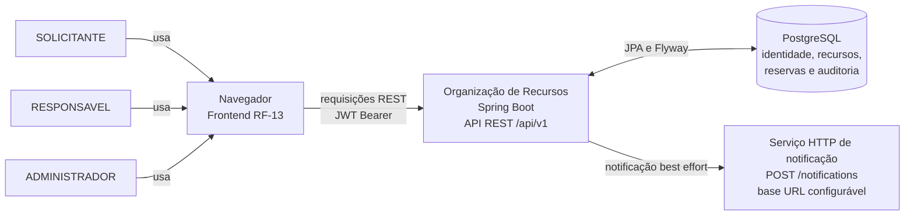

# Diagrama de contexto

O sistema é uma aplicação web acadêmica para pesquisar recursos, solicitar reservas e acompanhar decisões. Os perfis SOLICITANTE, RESPONSAVEL e ADMINISTRADOR acessam o cliente web; o backend Spring Boot expõe a API REST protegida por JWT e persiste os dados no PostgreSQL. Nas mudanças de reserva que notificam o solicitante, o backend chama um endpoint HTTP configurável. A falha desse serviço é tratada como não fatal pelo adaptador de notificação.

O cliente web RF-13 está em uma branch/PR separado do backend-base desta branch. Ele aparece como consumidor real da API, sem sugerir que seus arquivos estáticos já estejam em `origin/develop`.

## Limites representados

- PostgreSQL é o armazenamento relacional usado pelos repositórios Spring Data JPA; Flyway aplica as migrations no início da aplicação.
- O serviço de notificação é uma integração HTTP configurável (`app.notification.base-url`). A aplicação não exige que o serviço esteja disponível para concluir a operação de negócio.
- Não há provedor de identidade externo: login, BCrypt, emissão/validação de JWT e leitura de perfis são executados pelo backend.
- O frontend é cliente da API. A autorização continua sendo aplicada no backend.
