# Diagrama de componentes

O diagrama resume os componentes existentes em `br.com.organizacaorecursos`. A API REST passa primeiro pela configuração stateless do Spring Security. Controllers delegam regras aos serviços de aplicação; esses serviços usam entidades de domínio e repositórios Spring Data JPA. O `AuditService` é compartilhado pelos módulos de escrita, e notificações saem por uma porta de aplicação e seu adaptador HTTP.

```mermaid
flowchart TB
    client["Frontend web / clientes REST"]

    subgraph backend["Organização de Recursos — Spring Boot"]
        security["shared.infrastructure.config<br/>SecurityConfig · JWT · autorização<br/>CurrentUser · TraceIdFilter"]

        subgraph api["Adaptadores de entrada — API"]
            authApi["auth.api<br/>AuthController"]
            resourceApi["resource.api<br/>ResourceController"]
            reservationApi["reservation.api<br/>ReservationController"]
            approvalApi["approval.api<br/>ApprovalController"]
            maintenanceApi["maintenance.api<br/>MaintenanceController"]
            auditApi["audit.api<br/>AuditEventController"]
            reportApi["report.api<br/>UtilizationReportController"]
            errors["shared.api<br/>GlobalExceptionHandler · ApiErrorResponse"]
        end

        subgraph application["Aplicação e regras de uso"]
            authApp["auth.application<br/>LoginService · LocalIdentitySeeder"]
            resourceApp["resource.application<br/>ResourceService · ResourceValidator"]
            reservationApp["reservation.application<br/>ReservationService · AgendaConflictChecker"]
            approvalApp["approval.application<br/>ApprovalService"]
            maintenanceApp["maintenance.application<br/>MaintenanceService"]
            auditApp["audit.application<br/>AuditService · AuditQueryService"]
            reportApp["report.application<br/>UtilizationReportService"]
            notificationPort["notification.application<br/>NotificationPort · ReservationNotification"]
        end

        subgraph persistence["Repositórios Spring Data JPA"]
            repositories["User · Role · Resource · Reservation<br/>MaintenanceBlock · Approval · WithdrawalRecord<br/>AuditEvent repositories"]
        end

        subgraph domain["Entidades e regras de domínio"]
            entities["User · Role · Resource · Reservation<br/>MaintenanceBlock · Approval<br/>WithdrawalRecord · AuditEvent"]
            state["ReservationStateMachine<br/>ReservationStatus"]
        end

        notificationAdapter["notification.infrastructure<br/>HttpNotificationAdapter"]
        jwt["auth.infrastructure<br/>DatabaseUserDetailsService<br/>ActiveUserJwtConverter · JwtConfiguration"]
    end

    postgres[("PostgreSQL")]
    notificationService["Serviço HTTP de notificação<br/>POST /notifications"]

    client --> security
    security --> api
    authApi --> authApp
    resourceApi --> resourceApp
    reservationApi --> reservationApp
    approvalApi --> approvalApp
    maintenanceApi --> maintenanceApp
    auditApi --> auditApp
    reportApi --> reportApp

    security --> jwt
    authApp --> repositories
    resourceApp --> repositories
    reservationApp --> repositories
    approvalApp --> repositories
    maintenanceApp --> repositories
    auditApp --> repositories
    reportApp --> repositories

    resourceApp --> auditApp
    reservationApp --> auditApp
    approvalApp --> auditApp
    maintenanceApp --> auditApp
    reservationApp --> notificationPort
    approvalApp --> notificationPort
    notificationPort --> notificationAdapter
    notificationAdapter --> notificationService

    repositories --> entities
    entities --> state
    repositories <--> postgres
    jwt --> repositories
    errors -. trata erros da API .-> api
```

## Limites e dependências

- `SecurityConfig` configura sessão stateless, autenticação Bearer JWT e as rotas públicas de login, health e OpenAPI/Swagger. O conversor consulta o usuário ativo e carrega os papéis atuais do banco.
- Os controladores de aprovação delegam autorização contextual ao `ApprovalService`, que verifica solicitante, administrador e vínculo do responsável com os recursos restritos.
- A reserva coordena os repositórios de reserva, recurso e manutenção; o `AgendaConflictChecker` consulta sobreposições. Os locks de escrita das linhas de recurso são implementados em `ResourceRepository`.
- `AuditService` persiste eventos e valida a ausência de chaves sensíveis. `AuditQueryService` atende a consulta administrativa; a camada de aplicação não expõe alteração ou exclusão de eventos.
- A porta de notificação é chamada pelos fluxos de reserva e aprovação. O adaptador HTTP captura falhas do cliente remoto, registra aviso técnico e não propaga a exceção de transporte para a operação de negócio.
- Flyway cria/valida o schema PostgreSQL; as migrations não são representadas como repositório de aplicação porque são executadas pela inicialização da infraestrutura.
