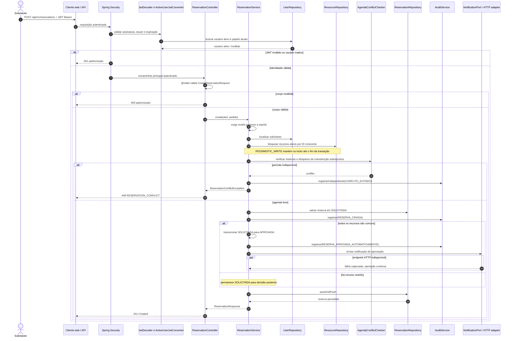

# Sequência: criação de reserva

O fluxo começa no `POST /api/v1/reservations`. O filtro de segurança valida o JWT e o usuário ativo; o controller valida o DTO; `ReservationService` verifica período, recursos, agenda e manutenção dentro de uma transação. Recursos comuns são aprovados automaticamente; quando há recurso restrito, a reserva fica solicitada para decisão posterior.

## Observações

- O filtro verifica JWT, issuer e expiração; `ActiveUserJwtConverter` busca o usuário no PostgreSQL em cada autenticação e deriva as authorities dos papéis atuais.
- A busca de recursos usa lock pessimista em ordem crescente de UUID. A disponibilidade é verificada por `AgendaConflictChecker`, que consulta reservas em estados que ocupam agenda e bloqueios de manutenção ativos.
- A auditoria de uma criação válida participa da transação de negócio. O evento `CONFLITO_EVITADO` é registrado com `REQUIRES_NEW`, por isso sobrevive ao rollback da tentativa conflitante.
- `HttpNotificationAdapter` tenta o POST configurado e captura exceções do cliente HTTP. A chamada é best effort; não há fila ou publicação assíncrona nesse fluxo.
