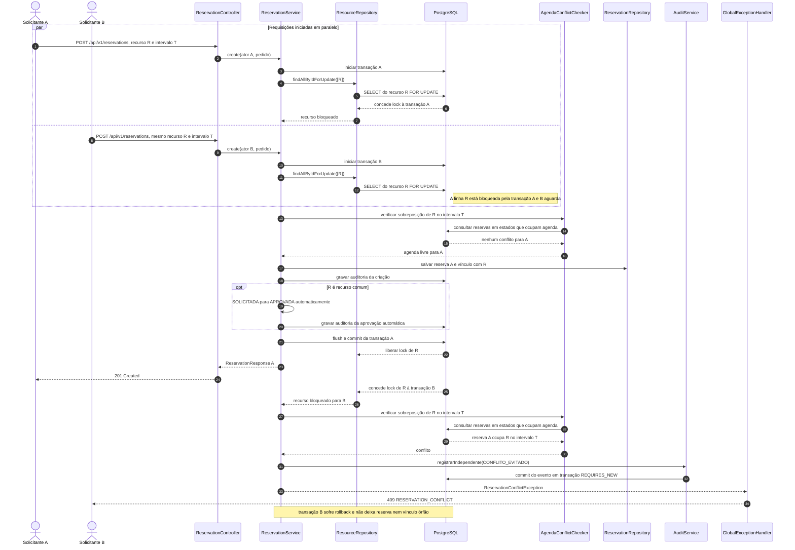

# Sequência: duas reservas concorrentes

O fluxo mostra duas requisições autenticadas tentando reservar o mesmo recurso no mesmo intervalo. A proteção é feita na aplicação com uma transação e lock pessimista (`PESSIMISTIC_WRITE`) da linha do recurso, selecionada em ordem crescente de ID. A segunda transação aguarda; depois do commit da primeira, sua consulta de agenda encontra a reserva e a API responde HTTP 409.

## Garantias e limites

- `ResourceRepository.findAllByIdForUpdate` usa `PESSIMISTIC_WRITE` e ordena os recursos por ID para reduzir deadlocks quando uma reserva contém vários recursos.
- A consulta de sobreposição considera os estados `SOLICITADA`, `APROVADA` e `EM_USO`, que ocupam agenda. A migration não define uma constraint de exclusão temporal; a serialização acontece pelo lock das linhas dos recursos antes da consulta.
- `ReservationService` é transacional. A tentativa conflitante grava `CONFLITO_EVITADO` em transação `REQUIRES_NEW`, lança `ReservationConflictException` e a camada HTTP mapeia essa exceção para `409 RESERVATION_CONFLICT`.
- `ReservationConcurrencyIntegrationTest` verifica uma criação `201`, as demais respostas `409` e ausência de reservas órfãs, inclusive para pedidos multi-recurso em ordem cruzada.
