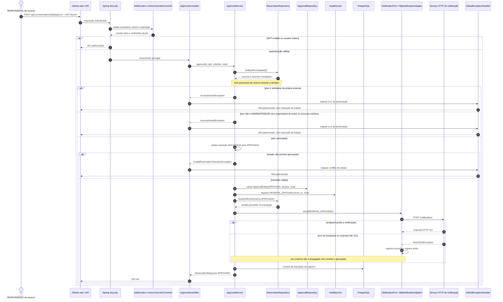

# Sequência: aprovação de reserva restrita

O responsável pelo recurso ou um administrador decide uma reserva no estado `SOLICITADA` pelo endpoint `POST /api/v1/reservations/{id}/approve`. `ApprovalService` bloqueia a reserva, valida a autorização contextual, registra a decisão e a auditoria, persiste a transição e tenta notificar o solicitante via HTTP.

## Regras representadas

- `/api/v1/**` exige autenticação. O conversor JWT consulta o usuário ativo e monta as authorities com os papéis atuais.
- A regra contextual é aplicada em `ApprovalService`: o solicitante não pode decidir a própria reserva; um administrador pode decidir; um responsável só pode decidir quando é responsável por todos os recursos restritos da reserva.
- A reserva é carregada com lock pessimista. A máquina de estados permite a transição `SOLICITADA → APROVADA`; uma transição inválida é tratada como HTTP 409.
- `ApprovalEntity`, `AuditEventEntity` e a mudança de estado são persistidas na transação de negócio. A migration mantém uma única decisão por reserva.
- A notificação é uma tentativa HTTP síncrona pelo `HttpNotificationAdapter`. Falha de conexão ou resposta HTTP não 2xx é capturada e registrada como aviso; não há fila nem rollback da decisão por falha externa.
- No código atual, a tentativa HTTP acontece depois de `saveAndFlush`, mas antes do commit final da transação de negócio.
