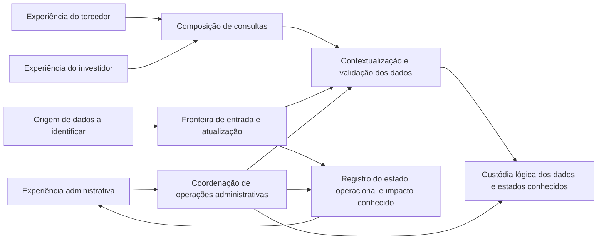

# Arquitetura conceitual agnóstica — Campeonato Brasileiro Série A

> **Status: proposta prematura, fora do fluxo atual e não aprovada.** Este documento é preservado apenas para referência e não deve ser utilizado como base para liberar implementação. Requisitos e arquitetura serão reavaliados após a validação da jornada e a derivação e aprovação dos requisitos funcionais e não funcionais.

**Status:** rascunho sujeito à validação. Os requisitos funcionais usados como base também são preliminares; este documento não aprova escopo nem transforma propostas em compromissos.

## Objetivo e escopo

Organizar responsabilidades conceituais para as experiências do torcedor, do investidor e do administrador, desde a origem ainda não identificada dos dados até sua consulta e operação administrativa. A arquitetura descreve limites, fluxos e contratos em nível lógico; não escolhe tecnologias, linguagens, frameworks, fornecedores, produtos, infraestrutura, protocolos, banco de dados ou stack.

O recorte diretamente sustentado é RF-01 a RF-08: consultas esportivas e de acessos e investigação/ação administrativa no cenário descrito. RF-09 a RF-12 permanecem propostas pendentes de validação. Não são definidos requisitos não funcionais, autenticação, autorização concreta, métricas, fontes, fórmulas, prazos, edição histórica, edição de dados ou recuperação automática.

## Princípios e restrições

- Organizar a experiência a partir das jornadas e separar consulta de operação administrativa.
- Manter dados associados às referências que forem conhecidas; não completar nem inferir informação ausente ou inconclusiva.
- Isolar a origem dos dados atrás de uma fronteira conceitual, pois fontes e formas de atualização não foram decididas.
- Não confundir estado de uma operação com confirmação da consistência dos dados.
- Tratar ações administrativas como solicitações explícitas, limitadas às ações e atribuições que vierem a ser validadas; não presumir correção automática.
- Preservar a rastreabilidade entre requisitos, componentes e fluxos. Mudanças decorrentes de RF-09 a RF-12 dependem de aprovação.

## Diagrama conceitual

O diagrama representa responsabilidades, não processos implantados ou garantias de disponibilidade. A origem pode ser uma ou mais fontes, ou depender de entrada administrativa; essa decisão está em aberto. A coordenação não implica que uma operação seja segura, permitida ou recuperável antes da definição das atribuições e regras correspondentes.

## Visão de front-end

As experiências são separadas por objetivo, sem pressupor login, personalização, navegação específica ou mecanismos de autorização.

| Experiência | Conteúdo sustentado | Contexto e limites de apresentação |
|---|---|---|
| Torcedor | Próximos confrontos, posição na competição, resultados recentes e desempenho ou score dos jogadores. | Associar informações ao time e às referências disponíveis de competição ou partida. A identificação do time, contexto histórico e interpretação do score seguem pendentes; ausência ou incerteza não deve ser apresentada como confirmação. |
| Investidor | Acessos associados aos times e desempenho dos times na competição. | Deixar clara a associação ao time e, quando conhecida, a referência do dado. Definição de acesso, período, indicadores e nível de detalhe não estão decididos; não presumir comparação válida nem relação causal. |
| Administrador | Estado conhecido da atualização com falha, dados identificados como afetados, solicitação de ações permitidas e resultado conhecido. | Distinguir falha, estado desconhecido e impacto não determinado. A tela não concede permissão por si só nem declara consistência sem evidência definida. |

A camada de apresentação consome resultados conceituais de consulta e operação, mostra suas referências conhecidas e mantém explícitas lacunas relevantes. A composição de telas, seleção de time, filtros e comportamento para cada estado são decisões de produto ainda não fechadas.

## Componentes lógicos de back-end

| Componente | Responsabilidade | Limites e dependências |
|---|---|---|
| Fronteira de entrada e atualização | Receber dados de origens que venham a ser identificadas e registrar o estado conhecido do processamento. | Não define fonte, formato, frequência, mecanismo de integração ou prazo. Expõe indisponibilidade e falha sem inventar dados. |
| Contextualização e validação | Relacionar informações a time, competição, partida, jogador e período somente quando essas associações forem conhecidas; identificar lacunas e incompatibilidades observáveis. | Não calcula score ou indicadores sem metodologia aprovada e não decide qual fonte prevalece em divergências. |
| Custódia lógica de dados e estados | Manter informações de domínio disponíveis para consulta e os estados operacionais necessários à investigação. | É uma responsabilidade lógica, não uma escolha de banco, esquema, retenção ou histórico. |
| Composição de consultas | Atender consultas de calendário, classificação, resultados, jogadores, acessos e desempenho por meio de dados contextualizados. | Expõe somente o escopo confirmado; compara dados apenas quando definição e referência compatíveis forem aprovadas. |
| Coordenação de operações administrativas | Receber uma ação administrativa definida, encaminhá-la ao responsável lógico apropriado e devolver o resultado conhecido. | Catálogo de ações, atribuições, aprovações, registro e recuperação dependem de validação. Não executa reparo automático nem amplia acesso ao banco por inferência. |
| Estado operacional e impacto | Tornar consultáveis o estado conhecido de uma atualização/operação e os dados identificados como afetados. | Não afirma completude nem consistência quando não houver evidência definida; detalhes de retenção e auditoria continuam pendentes. |

## Fluxos conceituais de dados

1. **Entrada:** uma origem ainda a identificar fornece ou recebe dados por um processo futuro. A fronteira de entrada registra o que foi observado e o estado conhecido; fonte, formato e atualização dependem das OQs.
2. **Contextualização:** dados recebidos são associados às entidades e referências que puderem ser identificadas. Lacunas, estados incompletos ou divergências permanecem explícitos, sem fórmula, estimativa ou regra de precedência presumida.
3. **Consulta:** a composição de consultas reúne os dados pertinentes ao pedido da persona e devolve valores junto das referências conhecidas e do estado de disponibilidade. A apresentação não transforma ausência de informação em resultado.
4. **Investigação administrativa:** uma falha ou estado de atualização é exposto com seu estado conhecido e os dados identificados como afetados. Informação inconclusiva permanece inconclusiva.
5. **Ação administrativa:** o administrador solicita uma ação definida e permitida após as atribuições serem estabelecidas. A coordenação registra o resultado conhecido e atualiza o estado observável; a confirmação de consistência é distinta e só poderá ser afirmada conforme evidências e critérios aprovados.

Esses fluxos não pressupõem fonte externa existente, atualização automática, edição histórica, prazo de processamento ou mecanismo de recuperação.

## Fronteiras e contratos conceituais

Os contratos abaixo descrevem significado e responsabilidade, não formato, protocolo ou interface técnica.

| Fronteira | Informação conceitual trocada | Regra de interpretação |
|---|---|---|
| Origem → entrada | Dados fornecidos e referências que a origem efetivamente disponibilizar. | Fontes, semântica, identidade, confiabilidade e forma de atualização precisam ser definidas (OQ-08 e OQ-09). |
| Entrada → contextualização | Dados recebidos e estado conhecido do processamento. | Distinguir sucesso, falha e estado não determinável segundo definições a validar; não presumir que recebimento confirma qualidade ou atualidade. |
| Contextualização ↔ custódia lógica | Dados associados a referências conhecidas, lacunas e estados observáveis. | Preservar as associações e incertezas sem impor esquema, retenção ou histórico. |
| Consulta ↔ experiência de usuário | Resultado da consulta, referências conhecidas e informação sobre disponibilidade ou incerteza. | O componente de consulta não inventa fonte, período, score, definição de acesso ou indicador. A apresentação deve evitar sugerir comparabilidade não confirmada. |
| Experiência administrativa → coordenação | Ação solicitada e contexto necessário para identificá-la. | Ações, escopo, atribuições e condições para executá-las devem ser aprovados; este contrato não especifica identidade, autenticação ou autorização. |
| Coordenação ↔ estado operacional/dados | Resultado conhecido da ação, estado da operação e impacto identificável. | Resultado operacional não equivale a consistência confirmada. Critérios e evidências de consistência dependem de OQ-12. |

## Segurança, privacidade e observabilidade

**Segurança e privacidade — preocupações, não políticas definidas.** O acesso administrativo a dados e operações, o escopo de acesso ao banco, a separação entre experiências e as atribuições de cada perfil precisam ser validados (OQ-06, OQ-07 e OQ-11). A necessidade de evitar exposição pessoal desnecessária é uma preocupação explícita para dados de acessos; nível de agregação, dados visíveis e regras de acesso não foram decididos. Este documento não escolhe autenticação, autorização, aprovação, auditoria, retenção ou controles concretos.

**Observabilidade operacional.** Para sustentar RF-07 e RF-08, a operação administrativa precisa conseguir consultar o estado conhecido de uma atualização, a falha quando identificável, os dados apontados como afetados e o resultado conhecido de uma ação solicitada. Deve ser possível distinguir “não confirmado” de “consistente”. Quais evidências, histórico, registro de auditoria e estados compõem essa visão dependem de OQ-06, OQ-09 e OQ-12. Não são definidos ferramentas, métricas ou prazos.

## Rastreabilidade requisito → componente/fluxo

| Requisito | Situação e componentes/fluxos relacionados |
|---|---|
| RF-01 | Diretamente sustentado. Composição de consultas; fluxo de consulta do torcedor para próximos confrontos. |
| RF-02 | Diretamente sustentado. Composição de consultas; fluxo de consulta da posição na competição. |
| RF-03 | Diretamente sustentado. Composição de consultas; fluxo de consulta de resultados recentes. |
| RF-04 | Diretamente sustentado para consulta. Composição de consultas e contextualização; fonte e metodologia do score não são assumidas. |
| RF-05 | Diretamente sustentado para consulta por time. Composição de consultas; definição de acesso e período permanecem pendentes. |
| RF-06 | Diretamente sustentado para consulta. Composição de consultas e contextualização; indicadores e referência não são presumidos. |
| RF-07 | Diretamente sustentado no cenário descrito. Entrada, estado operacional e impacto; fluxo de investigação administrativa. |
| RF-08 | Diretamente sustentado para ações permitidas no cenário. Coordenação de operações e estado operacional; catálogo e permissões não são definidos aqui. |
| RF-09 | Proposta pendente. Se aprovada, altera composição e apresentação das consultas de acesso para comparação; exige definições compatíveis de acesso e período. Não habilitada por este rascunho. |
| RF-10 | Proposta pendente. Se aprovada, amplia o contrato de consulta e apresentação para referências de competição, partida ou período definidas. Não implica temporada histórica. |
| RF-11 | Proposta pendente. Se aprovada, requer que contextualização e consulta exponham fonte e referência temporal validadas por indicador. Não escolhe fonte nem indicador. |
| RF-12 | Proposta pendente. Se aprovada, amplia o estado de operação para evidências e distinção explícita de consistência confirmada e não confirmada. Não define recuperação. |

## Riscos, decisões pendentes e impactos das OQs

| OQ | Decisão ainda aberta | Impacto arquitetural se respondida |
|---|---|---|
| OQ-01 | Definição de “acesso” por time. | Define a semântica que entrada, contextualização e consultas precisam preservar; sem ela, não há interpretação estável dos valores. |
| OQ-02 | Filtros e períodos para consulta/comparação de acessos. | Delimita referências temporais aceitas pela consulta e se comparações propostas podem ser coerentes (RF-09). |
| OQ-03 | Fonte, metodologia e explicação do score de jogador. | Pode exigir novas responsabilidades de contextualização e apresentação; até lá, a arquitetura apenas transporta informação disponível sem calcular ou explicar fórmula. |
| OQ-04 | Edição/temporada coberta e existência de dados históricos. | Altera o contexto de competição e o escopo das consultas; nenhum armazenamento ou fluxo histórico é assumido. |
| OQ-05 | Como o torcedor escolhe ou identifica o time. | Define a entrada e o contexto das consultas do torcedor, sem presumir conta, favorito ou personalização. |
| OQ-06 | Funções, ações, executores e escopo do acesso relacionado ao banco de dados. | Delimita operações administrativas e fronteiras de acesso; pode determinar se o acesso será mediado, sem escolher agora um mecanismo. |
| OQ-07 | Permissões por perfil e exigências de registro, aprovação ou recuperação. | Pode acrescentar etapas e controles ao contrato de operação e mudar o nível de detalhe das experiências do investidor; políticas não são inferidas. |
| OQ-08 | Fontes dos conjuntos de dados. | Determina as origens e responsabilidades necessárias na fronteira de entrada; nenhuma fonte existente é presumida. |
| OQ-09 | Como/quando atualizar e como identificar dados atrasados, incompletos, indisponíveis ou inconsistentes. | Define estados observáveis e tratamento de atualização; não implica prazo ou atualização automática antes da decisão. |
| OQ-10 | Indicadores que definem desempenho do time para o investidor. | Delimita dados e composição das consultas de desempenho, sem introduzir indicadores ou fórmulas. |
| OQ-11 | Nível de agregação e outros níveis de acesso do investidor. | Altera contratos de consulta e decisões de privacidade e acesso; a necessidade de evitar exposição pessoal permanece uma preocupação, não uma política fechada. |
| OQ-12 | Estados e evidências para confirmar consistência após ação administrativa. | Determina se e como o estado operacional pode declarar consistência; até lá, o resultado deve permanecer “não confirmado” quando não houver evidência definida. |

## Decisões e validação

**Base sustentada:** as jornadas e RF-01 a RF-08 orientam as responsabilidades e fluxos deste rascunho. **Propostas:** RF-09 a RF-12 só alteram o desenho se forem aprovadas. **Questões em aberto:** as OQs desta arquitetura preservam as decisões registradas em `requisitos-funcionais.md`; nenhuma recebe resposta normativa aqui.

Validar este rascunho com responsáveis de produto e pessoas que representem as três personas antes de tratá-lo como referência de implementação. Mudanças em fontes, semântica dos dados, operações administrativas, permissões ou contexto de competição podem alterar componentes e contratos sem exigir que as responsabilidades conceituais sejam substituídas por decisões tecnológicas neste documento.