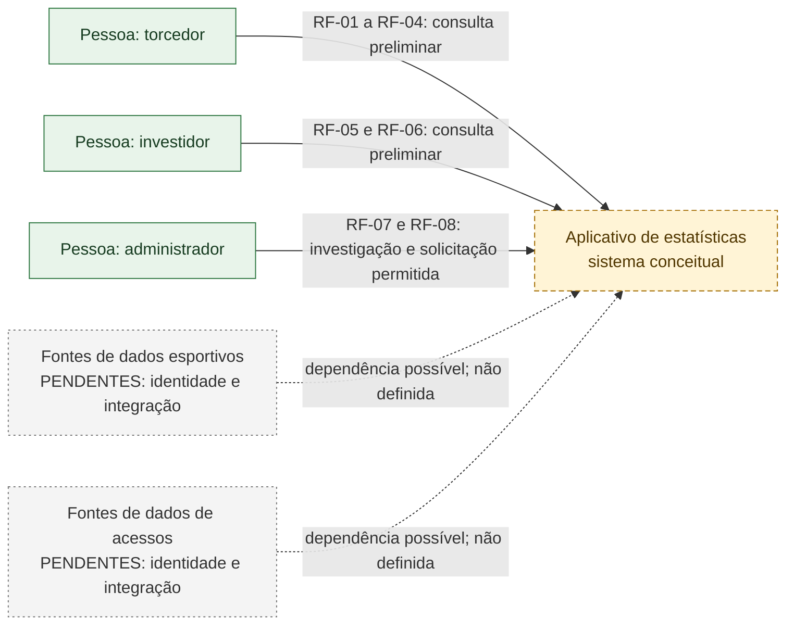
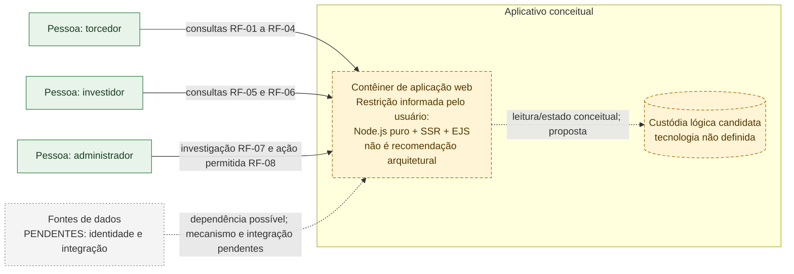
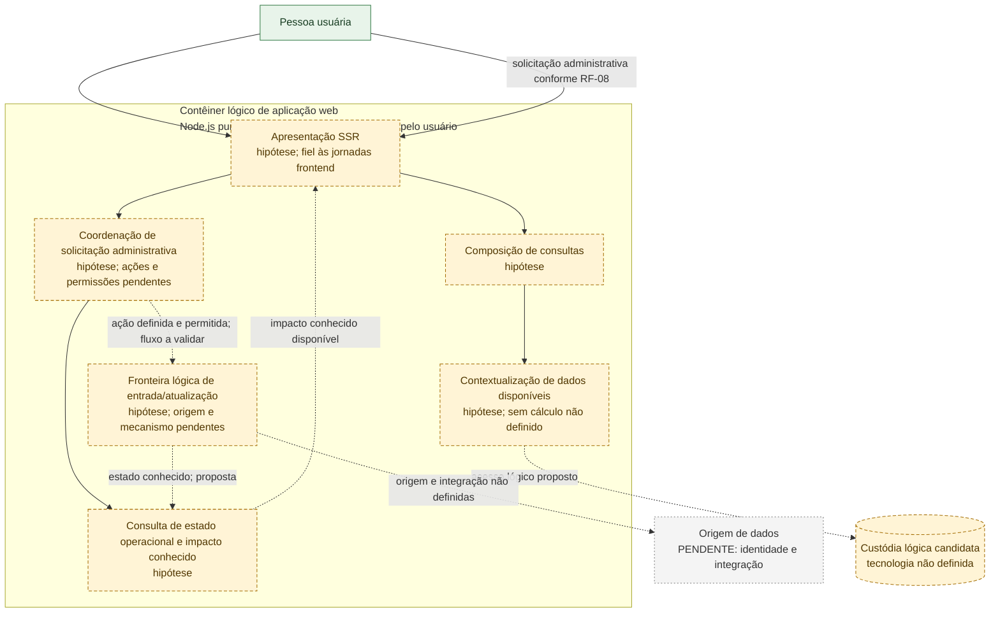
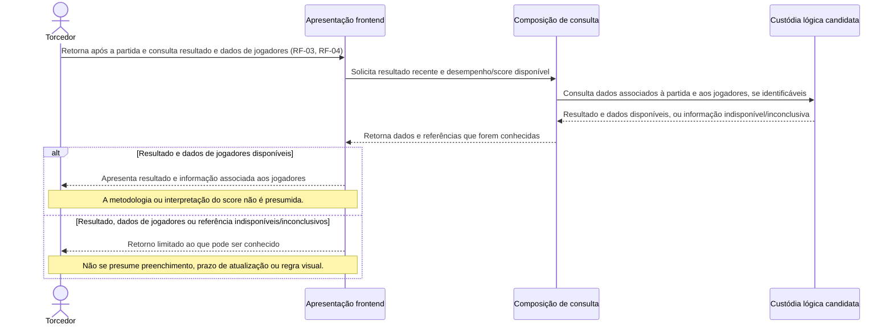
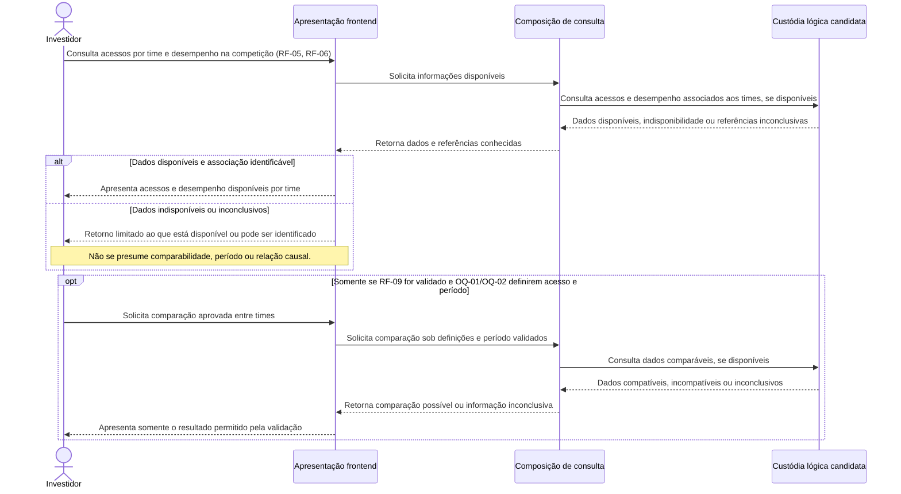
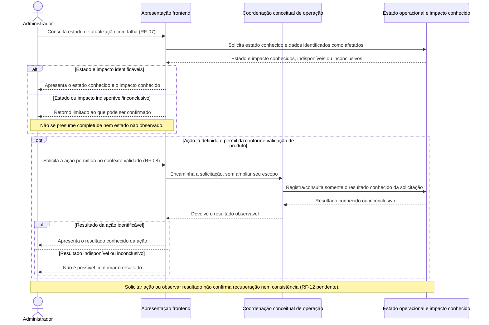

# Modelagem arquitetural — proposta para validação

> **Status: proposta prematura, fora do fluxo atual e não aprovada.** Este documento é preservado apenas para referência e não deve ser utilizado como base para liberar implementação. Requisitos e arquitetura serão reavaliados após a validação da jornada e a derivação e aprovação dos requisitos funcionais e não funcionais.

**Status:** proposta conceitual sujeita à validação do usuário. Este documento deriva estritamente de [Requisitos funcionais](requisitos-funcionais.md), [Arquitetura conceitual agnóstica](arquitetura-agnostica.md), [Jornadas de uso](jornadas-de-uso.md) e [Jornada frontend](jornada-frontend.md). Não aprova requisitos nem define implementação.

## Como interpretar

- **Confirmado preliminar:** capacidade diretamente sustentada por RF-01 a RF-08; os próprios requisitos continuam preliminares.
- **Hipótese arquitetural:** decomposição lógica proposta para representar responsabilidades e fluxos; depende de validação.
- **Pendente:** fonte, integração, tecnologia, decisão ou comportamento ainda não identificados/aprovados. Uma dependência desenhada com seta tracejada não representa integração existente.
- **Restrição informada pelo usuário:** para uma implementação futura, Node.js puro, SSR e EJS. É uma restrição do usuário, não uma recomendação ou decisão do arquiteto; sua aplicação continua sujeita ao gate deste documento.

RF-09 a RF-12 permanecem propostas a validar. Não se inferem NFRs, login, autenticação, autorização, dados ou fontes, métricas, fórmulas de score, prazos, histórico, catálogo de ações administrativas nem sucesso de recuperação.

## C4 — C1: Contexto

O sistema no centro é o aplicativo conceitual descrito nas fontes, não uma declaração de que já exista uma aplicação implementada. As capacidades apresentadas como preliminares limitam-se a RF-01 a RF-08. As fontes externas são placeholders de dependências desconhecidas, não integrações existentes.



**Legenda:** verde = atores/capacidades descritos nas fontes preliminares; amarelo tracejado = sistema conceitual; cinza tracejado = dependência externa ainda não identificada. As ligações tracejadas não afirmam conexão ou fornecedor existente.

## C4 — C2: Contêineres

Os contêineres abaixo são uma representação lógica proposta, não topologia implantada. O contêiner de aplicação registra a restrição futura informada pelo usuário. A custódia lógica é candidata, com tecnologia não definida; sua representação serve apenas para explicar o fluxo de consulta e estado.



**Limites:** não se escolhem banco de dados, protocolo, provedor, infraestrutura, formato de integração ou implantação. A caixa de fontes não corresponde a serviço conectado. A caixa de custódia não confirma persistência já existente nem define esquema, retenção ou histórico.

## C4 — C3: Componentes

Componentes internos são hipóteses de responsabilidade dentro do contêiner lógico de aplicação. A apresentação deve permanecer estritamente fiel à jornada frontend conceitual abaixo; o diagrama não prescreve telas, navegação, controles ou mensagens.



As setas tracejadas representam relações conceituais propostas, não contratos técnicos ou integrações implantadas. A existência de uma fronteira lógica de entrada/atualização decorre do cenário de falha descrito; suas fontes e funcionamento continuam desconhecidos.

## Jornadas frontend conceituais por persona

Resumo da [Jornada frontend](jornada-frontend.md), sem acrescentar telas, rotas, controles, mensagens ou comportamento. “Aprovada conceitualmente” aqui significa apenas a sequência descrita nessa fonte; não significa validação final do produto.

| Persona | Jornada conceitual sustentada | Limite da experiência descrita |
|---|---|---|
| Torcedor | Antes da partida, consulta próximos confrontos e posição; depois, retorna para consultar resultado recente e desempenho/score disponível de jogadores. | Time de interesse, apresentação e referências permanecem sem mecanismo definido; interpretação do score depende de definição validada. RF-01 a RF-04. |
| Investidor | Consulta acessos associados aos times e desempenho dos times na competição. | Comparar acessos não é comportamento aprovado: RF-09 e as definições de acesso/período precisam ser validadas antes de especificar essa experiência. RF-05 e RF-06. |
| Administrador | Investiga estado conhecido da falha e impacto identificável, solicita ação permitida e observa o resultado conhecido. | Não presume catálogo, permissão concreta, tela, recuperação, consistência confirmada ou sucesso. RF-07 e RF-08; RF-12 segue pendente. |

Estados disponíveis, ausentes ou inconclusivos são mencionados somente nos termos das jornadas de origem. Forma de apresentação e regras de tratamento não são decididas aqui.

## Sequências conceituais

Os participantes têm nomes agnósticos. “Custódia lógica candidata” é uma fronteira explicativa, não uma tecnologia ou recurso confirmado. Fragmentos `alt` e `opt` registram alternativas condicionais das fontes, não políticas novas.

### (a) Torcedor consulta próximos confrontos e posição

```mermaid
sequenceDiagram
    actor Torcedor
    participant Frontend as Apresentação frontend
    participant Consulta as Composição de consulta
    participant Dados as Custódia lógica candidata

    Torcedor->>Frontend: Consulta próximos confrontos e posição do time (RF-01, RF-02)
    Frontend->>Consulta: Solicita informações disponíveis para o contexto consultado
    Consulta->>Dados: Consulta confronto e posição associados, se disponíveis
    Dados-->>Consulta: Dados disponíveis, indisponibilidade ou estado inconclusivo
    Consulta-->>Frontend: Retorna informação e referências conhecidas
    alt Informação disponível e referência identificável
        Frontend-->>Torcedor: Apresenta próximo confronto e posição disponíveis
    else Informação indisponível ou inconclusiva
        Frontend-->>Torcedor: Retorno correspondente à informação conhecida ou inconclusiva
        Note over Frontend,Torcedor: Forma visual e mensagem permanecem pendentes; não se presume tratamento.
    end
```

### (b) Torcedor retorna após partida para resultado e dados de jogadores



### (c) Investidor consulta acessos e desempenho



O fragmento de comparação é uma alternativa condicionada, não uma capacidade atual nem uma decisão de design. Se RF-09 ou as definições de acesso/período não forem validadas, esse fragmento não se aplica.

### (d) Administrador investiga falha, impacto conhecido e solicita ação permitida



O catálogo de ações, as permissões e as condições de execução não são presumidos. RF-12 continua sujeito a validação; portanto, resultado operacional não equivale a consistência confirmada.

## Elementos, rastreabilidade e decisões

| Elemento/decisão | Situação nesta proposta | Rastreabilidade |
|---|---|---|
| Consultas de confrontos, posição, resultados e jogadores | Capacidades preliminares; responsabilidades internas são hipóteses. | RF-01 a RF-04; jornada frontend do torcedor. |
| Consultas de acessos e desempenho por time | Capacidades preliminares; sem definição de métrica, período ou indicadores. | RF-05 e RF-06; OQ-01, OQ-02, OQ-10 e OQ-11. |
| Comparação de acessos | Alternativa não habilitada; só se RF-09 e OQ-01/OQ-02 forem validados. | RF-09; OQ-01 e OQ-02. |
| Investigação e solicitação administrativa | Capacidades preliminares no escopo descrito; ação concreta e atribuições não definidas. | RF-07 e RF-08; OQ-06, OQ-07 e OQ-12. |
| Consistência após ação | Não afirmada; possível ampliação depende da validação. | RF-12; OQ-12. |
| Fontes, integração e custódia | Fontes/integrações pendentes; custódia é candidata e sem tecnologia definida. | Arquitetura agnóstica; OQ-08 e OQ-09. |
| Node.js puro, SSR e EJS | Restrição informada pelo usuário para implementação futura; não é recomendação do arquiteto nem aprovação para iniciar. | Instrução explícita do usuário nesta solicitação. |

**Rastreabilidade dos requisitos:** RF-01 a RF-08 são preliminares diretamente sustentados, não decisões de implementação. RF-09 a RF-12 continuam propostas a validar. Os diagramas não elevam o status de nenhum requisito.

**Rastreabilidade das questões abertas:** OQ-01/OQ-02 condicionam qualquer comparação; OQ-03 impede presumir fórmula ou interpretação de score; OQ-04/OQ-05 deixam período histórico e identificação do time em aberto; OQ-06/OQ-07 impedem inferir catálogo, permissões ou controles; OQ-08/OQ-09 mantêm fontes e atualização pendentes; OQ-10/OQ-11 mantêm indicadores e nível de acesso pendentes; OQ-12 impede declarar consistência sem critérios/evidências validados.

## Riscos e cautelas

- Tratar componentes ou setas conceituais como existentes criaria compromissos falsos sobre integração, armazenamento ou operação.
- Comparar acessos antes de definir unidade e período pode produzir leitura incompatível; a alternativa permanece condicionada à validação de RF-09, OQ-01 e OQ-02.
- Apresentar score, desempenho ou impacto sem referência identificável pode sugerir certeza que as fontes não sustentam.
- Confundir solicitação ou resultado de ação com recuperação confirmada pode levar a declarar consistência sem evidência; RF-12 e OQ-12 seguem pendentes.
- A restrição de implementação informada pelo usuário não resolve as decisões funcionais, fontes, permissões ou persistência e não autoriza início de implementação.

## Gate de validação

**Nenhuma implementação começa até o usuário aprovar esta documentação.** A aprovação deve validar ou devolver para revisão a proposta, especialmente os limites das jornadas, as hipóteses dos diagramas, a restrição de implementação informada pelo usuário e as questões em aberto. Até essa aprovação, todo componente permanece conceitual, toda dependência externa permanece pendente e RF-09 a RF-12 permanecem propostas.